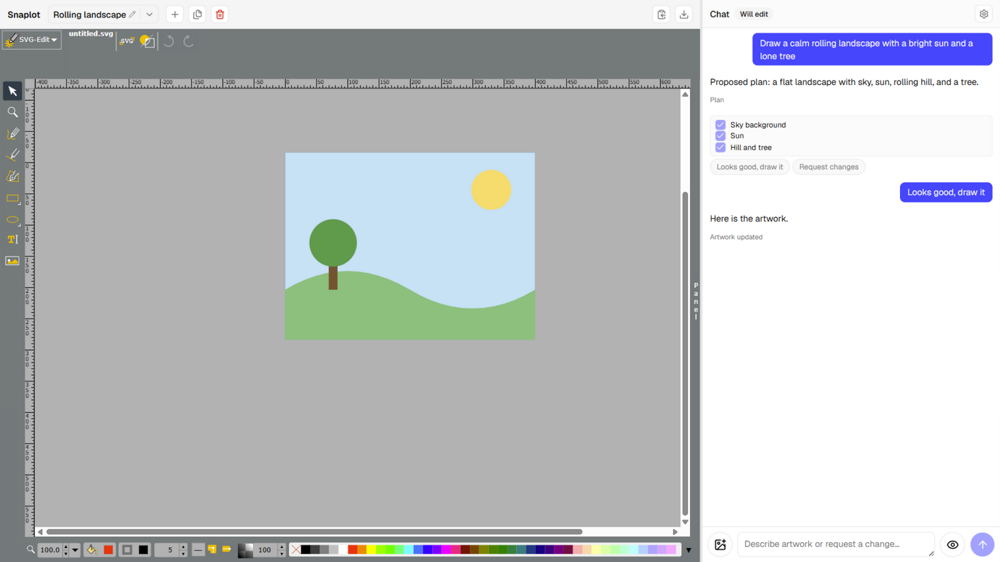

# Snaplot

A local-first, AI-powered SVG design workspace. Describe an idea in chat, watch the assistant draw it, refine it by chatting or editing directly on the canvas, and export as SVG or PNG.



The editor and project storage run in your browser. AI requests go through a local Vite development server to your configured OpenAI-compatible provider. You bring your own API key; Snaplot stores it in this browser and sends it through the local proxy to authenticate provider requests.

The repository is ready to run locally. AI features require the development server; the static build alone does not include the API proxy.

## Features

- **Chat-driven generation and refinement** — the assistant streams a design plan for confirmation, then builds the artwork; follow-up messages apply targeted, validated edits.
- **Editable plan checklist** — skip or rename drawing steps before the first build; your adjustments steer what gets drawn.
- **Visual SVG editing** — the artwork loads into an embedded [SVG-Edit v7](https://github.com/SVG-Edit/svgedit) canvas for direct manual refinement alongside the AI.
- **Selection-aware edits** — ask about the element you selected; the assistant prioritizes it.
- **Fail-closed sanitizer** — every SVG passes parse → validate → sanitize → canonicalize → stable IDs before it reaches the editor. No scripts, event handlers, or external references.
- **Atomic edits and reply rollback** — edit operations apply all-or-nothing against a detached DOM copy; withdrawing an artwork-changing reply restores the artwork snapshot from before that turn and removes that turn and later turns.
- **Reference images** — attach, paste, or drop PNG, JPEG, WebP, or GIF images into chat to guide a vision-capable model.
- **Visual review (optional)** — the browser rasterizes the artwork, then a vision-capable model inspects it against your intent; failures feed the automatic retry loop.
- **Projects** — multiple projects with IndexedDB persistence, debounced autosave, and automatic migration of an earlier draft.
- **Export** — current editor state as standalone SVG or PNG, plus PNG copying to the clipboard.

## Getting started

Requirements:

- [Node.js](https://nodejs.org/) 22.20+ on the 22.x release line, or 24.12+. Development checks for this revision passed on Node.js 24.12.
- npm, included with Node.js.
- An OpenAI-compatible provider with a model that supports streaming Chat Completions and native tool calling.

Clone this repository or download its source, then run these commands from the project directory:

```bash
npm install
npm run dev
```

Open the printed URL (default `http://localhost:5173`), click **Settings** in the chat panel, and configure:

| Field | Value |
|-------|-------|
| Base URL | Your provider's API path, e.g. `https://api.openai.com/v1` |
| API key | Your provider's key; saved in browser-local settings |
| Model | The exact model ID from your provider, with streaming and tool-calling support |

Click **Test connection**, then describe the artwork you want, for example: "Draw a calm rolling landscape with a bright sun and a lone tree." Adjust the proposed checklist if needed and click **Looks good, draw it**. Once the artwork appears, refine it through chat or the canvas and use **Export** to save SVG or PNG.

For reference images and visual review, configure a vision-capable **Vision model**, or leave it empty if the main model supports images. Automatic visual review runs after the first artwork by default; choose **Never** to disable it. Reviews make additional provider requests, including retries when issues are found.

### Trying it without an API key

A scripted fake provider ships with the repo for trying the plan, build, and edit flow. Keep `npm run dev` running and start the provider in another terminal:

```bash
node scripts/fakeProvider.mjs   # serves http://localhost:8787/v1
```

In **Settings**, set **Base URL** to `http://localhost:8787/v1`, **API key** and **Model** to `demo`, and **Automatic visual review** to **Never**. Ask for a landscape, confirm the plan, then try "Make the sun darker."

This provider returns scripted artwork and edits; it does not generate arbitrary designs or perform visual review.

### Provider compatibility

The proxy uses the OpenAI Chat Completions format (`/chat/completions`) and Bearer authentication. Use the provider's full compatible API base path, such as `https://api.openai.com/v1`, rather than its website URL.

The development proxy's host allowlist includes:

| Provider | Allowed HTTPS host |
|----------|--------------------|
| OpenAI | `api.openai.com` |
| Anthropic | `api.anthropic.com` |
| DeepSeek | `api.deepseek.com` |
| Moonshot (Kimi) | `api.moonshot.cn` |
| Zhipu BigModel | `open.bigmodel.cn` |
| SiliconFlow | `api.siliconflow.cn` |
| Alibaba DashScope | `dashscope.aliyuncs.com` |

Local HTTP endpoints on `localhost` or `127.0.0.1` are also allowed. They still need a compatible model with streaming and tool calling, and the proxy requires a non-empty API key field even for a server without authentication.

These hosts are allowed by the proxy, not a list of verified provider/model combinations. There is no native Anthropic Messages API adapter. To use another host, update the allowlist in [src/server/chatProxy.ts](src/server/chatProxy.ts) and restart the development server.

## Local storage and privacy

- Projects, artwork, chat history, and attached reference images are saved in IndexedDB. Provider settings, including the API key, are saved in `localStorage` under `snaplot.settings.v1`.
- Storage belongs to the current browser profile and origin (scheme, host, and port). Changing the URL or browser can show a separate workspace; clearing site data removes saved projects and settings. There is no cloud sync.
- AI requests send conversation context, the current SVG, and selection details through the local proxy to your provider. Recent reference images are included when attached; visual review sends a rendered PNG of the artwork.
- Snaplot does not include the configured API key in chat history. The development proxy logs assistant text and a reasoning excerpt to its terminal, so those logs may contain design details.
- Export SVG or PNG to keep a copy of your artwork. These exports do not back up chat history or project settings.

## How it works

The user-facing mental model:

```text
Describe -> Confirm plan -> See artwork -> Chat or manually tweak -> Export
```

Internally, every message runs a staged agent turn:

```text
UNDERSTAND → PLAN → AWAIT_CONFIRM → IMPLEMENT → VERIFY → REPORT
     ↑                                            │
     └──── (verify failure: tool-result feedback, retry ≤ 2) ────┘
```

The assistant replies with native tool calls — `propose_plan`, `build_svg`, `apply_edits`, `ask_question` — one per reply. All programmatic checks (sanitization, element budgets, edit-target validation, all-or-nothing apply) are centralized in `src/svg/verify.ts`; failures are fed back to the model as tool results so it can correct itself. The current editor SVG is always the source of truth and is canonicalized before every request — the model never sees a stale copy.

See [docs/workflow.md](docs/workflow.md) for the full turn contract and [docs/r0-findings.md](docs/r0-findings.md) for validated SVG-Edit integration facts.

## Build and deployment

```bash
npm run build      # Type-check and create the static frontend in dist/
npm run preview    # Preview the static frontend locally
```

The bundled `POST /api/chat` endpoint is **development-only** Vite middleware. It is available with `npm run dev`, but is absent from `dist/` and `npm run preview`. Publishing the repository on GitHub lets others clone and run Snaplot locally; hosting the static build on GitHub Pages alone does not enable AI generation, refinement, or visual review.

A hosted version needs a server-side `/api/chat` implementation compatible with [src/services/streamClient.ts](src/services/streamClient.ts), including its NDJSON response stream and tool-call events. That server must handle rate limits, API key handling, and abuse controls. For now, use the local development server for the complete workflow.

## Troubleshooting

| Symptom | Check |
|---------|-------|
| Dependency engine errors | Check `node --version` and use the Node.js version listed above. |
| `baseUrl not allowed or missing apiKey/model/messages` | Check the host allowlist, full API base path, and non-empty key/model fields. |
| Authentication or model errors | Check the provider's API key and exact model ID; a connection test does not verify tool or image support. |
| Chat fails in a static preview or GitHub Pages | Run `npm run dev`, or supply the server-side proxy described above. |
| Image input or visual review fails | Select a vision-capable model, or disable automatic review for text-only models. |
| Saved projects appear missing | Return to the same browser profile, host, and port used to create them. |

## Development

```bash
npm run dev        # Vite dev server (includes the /api/chat dev proxy)
npm test           # Vitest, single run
npm run test:watch # Vitest in watch mode
npm run build      # tsc -b && vite build (TypeScript strict mode)
```

The stack: Vite, React 19, TypeScript (strict), Zustand, Tailwind CSS v4, shadcn/ui (Radix), SVG-Edit v7, Vitest.

Key layout:

| Path | Role |
|------|------|
| `src/services/` | Agent turn state machine, tool declarations, prompts, streaming client, vision review |
| `src/svg/` | SVG pipeline: extract, sanitize, canonicalize, stable IDs, edits, verify |
| `src/editor/` | The single wrapper around the SVG-Edit API |
| `src/stores/` | Zustand stores: settings, chat, editor, projects |
| `src/components/` | Presentation-oriented React components |
| `src/server/` | Dev-only `/api/chat` proxy middleware |
| `docs/` | Workflow spec, integration findings, and the original [build plan](docs/build-plan.md) |

Agent-oriented development guidance lives in [AGENTS.md](AGENTS.md). Parser, sanitizer, edit, state, and streaming services are developed test-first; run `npm test` after touching `src/svg/`, `src/services/`, or `src/stores/`.

## Security notes

- API keys live in browser-local settings, pass through the local proxy for provider authentication, and are redacted from provider error details before display.
- The sanitizer fails closed: unknown elements and attributes are stripped, and SVGs that cannot be sanitized safely are rejected.
- Screenshots for visual review exist only inside that single request; they are never persisted to chat history or project storage.

## License

[MIT](LICENSE). Icon assets under `public/svgedit/images/` and `public/images/` come from SVG-Edit and remain under their original licenses (see the third-party notices in [LICENSE](LICENSE)).
